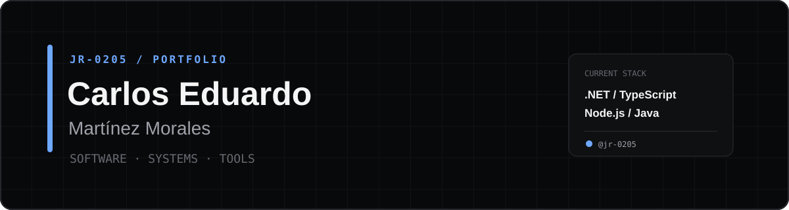

<div align="center">
  
</div>

# Carlos Eduardo Martínez Morales

**Ingeniería en Sistemas Computacionales · Software Developer**

Construyo proyectos que cruzan **backend, aplicaciones de escritorio, frontend y tooling**. Mi trabajo público incluye lanzadores para Windows, APIs con TypeScript, utilidades de sistema, mods con Fabric, herramientas web para Minecraft y una app Flutter de transferencia en red local.

[CV online](https://jr-0205.github.io/mi-cv-online/#inicio) · [Repositorios](https://github.com/jr-0205?tab=repositories)

---

## Perfil

Mi objetivo es convertir problemas concretos en software que pueda **entenderse, probarse y mantenerse**. Antes de añadir complejidad intento definir el flujo, separar responsabilidades, conservar estados importantes y documentar límites.

Actualmente trabajo con:

`C#` · `.NET` · `WPF` · `WebView2` · `React` · `TypeScript` · `Node.js` · `Express` · `Prisma` · `MySQL` · `SQLite` · `Dart` · `Flutter` · `Java` · `Fabric` · `Gradle` · `PowerShell` · `PHP` · `HTML` · `CSS` · `JavaScript`

## Trabajo destacado

| Proyecto | Área | Qué demuestra |
| --- | --- | --- |
| [J-SCAN](https://github.com/jr-0205/j-scan) | Móvil + Escritorio | Envío de texto, archivos y documentos escaneados de Android a Windows por red local, con cifrado de extremo a extremo y funcionamiento sin internet. |
| [NEXA Client](https://github.com/jr-0205/nexa-client-premium) | Desktop / Minecraft | Lanzador nativo para Windows con .NET 10, WPF/WebView2 y React; perfiles aislados, loaders, Java, contenido instalado, logs e instalador x64. |
| [Windows 11 Optimizer](https://github.com/jr-0205/win11) | Desktop / Sistemas | Aplicación WPF en .NET 8 para medir y reducir actividad en segundo plano con backup, reversibilidad y modos de virtualización. |
| [TrafficMonitorJr](https://github.com/jr-0205/traffic-monitor-jr) | Desktop / Sistemas | Empaquetado de TrafficMonitor en un único ejecutable para Windows, con plugin nativo IPv4 y reparación del runtime. |
| [AUT-INS API](https://github.com/jr-0205/aut-ins-api) | Backend | API modular con TypeScript, Express, Prisma y MySQL para procesos de admisión e inscripción escolar. |
| [Comet Movies](https://github.com/jr-0205/api-prueba) | API + Web | Catálogo con autenticación, perfiles, favoritos, roles, CRUD administrativo, SQLite y despliegue demostrativo. |
| [CobbleSort](https://github.com/jr-0205/cobblesort) | Java / Fabric | Mod de cliente para Minecraft 1.21.1 que ordena inventarios y prioriza objetos de Cobblemon. |
| [Mini-Skin Studio](https://github.com/jr-0205/skin) | Frontend | Herramientas web para combinar skins, crear peluches y editar texturas con procesamiento local. |
| [Grupos Huevo · Cobblemon](https://github.com/jr-0205/grupo-huevo-cobblemon) | Frontend / Datos | Guía local con filtros por Pokémon, grupo huevo y generación, diseñada para consulta rápida y responsive. |

## Mapa de repositorios públicos

Ordenado por área. Los 18 repositorios públicos de la cuenta.

### Desktop y sistemas

| Repositorio | Enfoque | Tecnologías visibles |
| --- | --- | --- |
| [win11](https://github.com/jr-0205/win11) | Windows 11 Optimizer | C#, .NET 8, WPF, PowerShell |
| [traffic-monitor-jr](https://github.com/jr-0205/traffic-monitor-jr) | Lanzador de TrafficMonitor en un solo .exe | C#, PowerShell, C++, GitHub Actions |
| [nexa-client-premium](https://github.com/jr-0205/nexa-client-premium) | Base pública de NEXA Client | .NET 10, C#, WPF, WebView2, React, TypeScript |

### Backend y APIs

| Repositorio | Enfoque | Tecnologías visibles |
| --- | --- | --- |
| [aut-ins-api](https://github.com/jr-0205/aut-ins-api) | Plataforma académica de admisión | TypeScript, Express, Prisma, MySQL |
| [api-prueba](https://github.com/jr-0205/api-prueba) | Comet Movies API + catálogo | Node.js, Express, SQLite, HTML, CSS, JavaScript |
| [papeleria](https://github.com/jr-0205/papeleria) | Sistema de papelería | PHP |

### Microservicios (proyecto académico)

Cuatro servicios desplegables con Docker, un estándar compartido de contratos y un script único que propaga la configuración de red a todos.

| Repositorio | Enfoque | Tecnologías visibles |
| --- | --- | --- |
| [equipo-1-clientes-productos](https://github.com/jr-0205/equipo-1-clientes-productos) | Servicios de clientes y productos | JavaScript, Node.js, Docker |
| [equipo-2-pedidos-pagos](https://github.com/jr-0205/equipo-2-pedidos-pagos) | Servicios de pedidos y pagos | JavaScript, Node.js, Docker |
| [equipo-3-inventario-notificaciones](https://github.com/jr-0205/equipo-3-inventario-notificaciones) | Inventario y notificaciones | JavaScript, Node.js, Docker |
| [front-microservicios](https://github.com/jr-0205/front-microservicios) | Frontend del POS integrado | JavaScript, Vite, React, Nginx, Docker |
| [kubernetes-2](https://github.com/jr-0205/kubernetes-2) | Tienda desplegada en Kubernetes | Flask, Nginx, Docker, Minikube |

### Frontend y web

| Repositorio | Enfoque | Tecnologías visibles |
| --- | --- | --- |
| [skin](https://github.com/jr-0205/skin) | Mini-Skin Studio | HTML, CSS, JavaScript, Canvas |
| [grupo-huevo-cobblemon](https://github.com/jr-0205/grupo-huevo-cobblemon) | Consulta de compatibilidad Pokémon | HTML, CSS, JavaScript |
| [mi-cv-online](https://github.com/jr-0205/mi-cv-online) | CV y portafolio web | HTML, CSS, JavaScript, EmailJS |

### Minecraft, móvil y datos

| Repositorio | Enfoque | Tecnologías visibles |
| --- | --- | --- |
| [cobblesort](https://github.com/jr-0205/cobblesort) | Mod de ordenamiento para Minecraft | Java 21, Fabric, Gradle |
| [j-scan](https://github.com/jr-0205/j-scan) | Transferencia y escaneo sin internet | Dart, Flutter, mDNS, cifrado E2E |
| [actividades-fany](https://github.com/jr-0205/actividades-fany) | Prácticas de cursos y experimentos | Python, Jupyter, Google Colab |

### Perfil

| Repositorio | Enfoque | Tecnologías visibles |
| --- | --- | --- |
| [JR-0205](https://github.com/jr-0205/JR-0205) | Perfil técnico de GitHub | Markdown, SVG |

## Cómo trabajo

```text
Problema
  ↓
Flujo y alcance
  ↓
Contrato / modelo
  ↓
Implementación pequeña
  ↓
Validación y pruebas
  ↓
Documentación
  ↓
Refinamiento visual y técnico
```

Principios que intento mantener en los proyectos:

- separar lógica, persistencia y presentación;
- tratar operaciones destructivas con confirmación y reversibilidad;
- validar entradas y estados antes de ejecutar cambios;
- documentar instalación, compatibilidad y límites conocidos;
- preferir interfaces claras antes que pantallas llenas de controles;
- mantener los detalles técnicos disponibles sin obligar al usuario normal a entenderlos.

## Áreas que estoy fortaleciendo

**Backend:** contratos HTTP, autorización, persistencia relacional, Prisma, pruebas e integración.

**Desktop:** WPF, WebView2, arquitectura por capas, automatización de builds e instaladores de Windows.

**Frontend:** interfaces responsive, estados accesibles, jerarquía visual y componentes claros.

**Minecraft tooling:** Java 21, Fabric, Gradle, manipulación segura de inventarios y herramientas de cliente.

**Móvil y red:** Flutter, descubrimiento de dispositivos local, transferencia cifrada y modo sin conexión.

## Demo pública

**Comet Movies:** https://api-prueba-9hox.onrender.com/

> Las cuentas y datos de demostración descritos dentro de los proyectos son ficticios. No uso información personal real como contenido de prueba.

---

<div align="center">
  <sub>Software, systems & tools · @jr-0205</sub>
</div>
